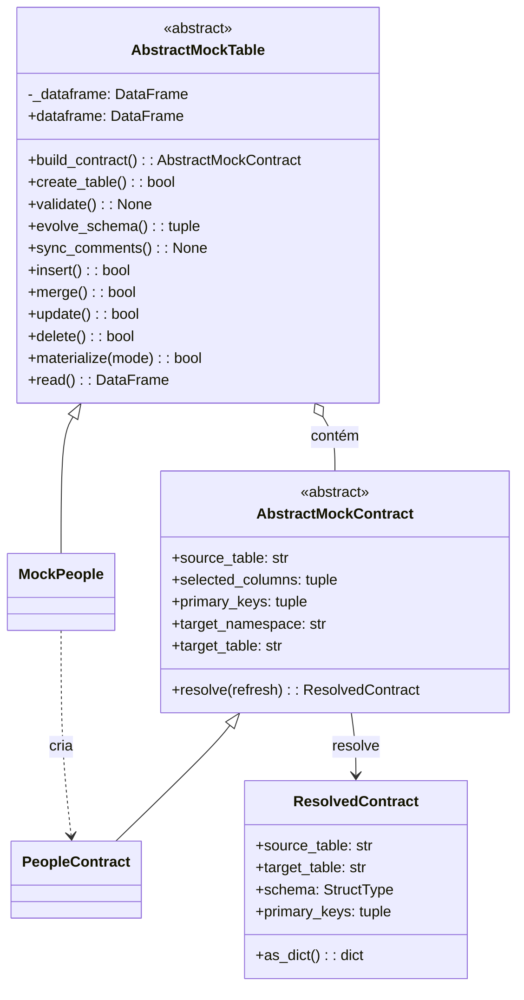
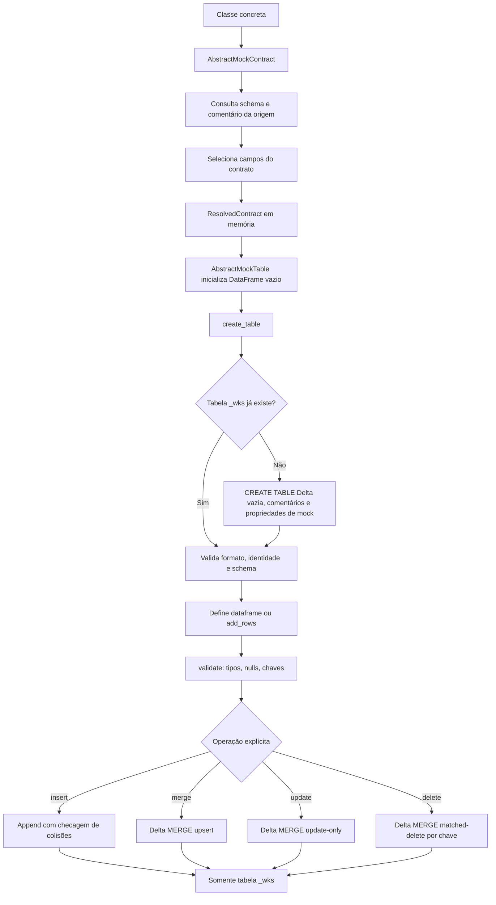

# pipelines de dados — MockTable para dados E2E (Databricks / PySpark / Delta)

**Artefatos:** `mock_table.py` (biblioteca pronta para colar/importar), `example_people.py` (padrão de herança), `tests/test_mock_table.py` (testes isolados). A biblioteca não depende do código SAFRA nem do OLIST.

## Objetivo e escopo

Gerenciar tabelas **sintéticas** em `catalog.synthetic_wks.nome_da_tabela`, copiando **somente metadados relevantes** de colunas selecionadas da origem: tipo Spark, nullability e comentário. O contrato é declarado pela tabela concreta. Os dados devem ser sintéticos e inseridos explicitamente pelo usuário.

> **Segurança**: a classe consulta apenas o **schema** da origem (`spark.table(origem).schema`), não faz `collect`/`count` nem cópia de linhas da origem. Permissões de catálogo e permissões de escrita no `_wks` ainda são exigidas. A verificação de natureza sintética da massa de entrada é uma responsabilidade de quem prepara o DataFrame; o código não consegue demonstrar que valores fornecidos manualmente não são dados reais.

## Diagrama de classes



## Fluxo de criação vazia e posterior persistência



## Uso no Databricks

Crie `MockPeople` herdando de `AbstractMockTable`, e `PeopleContract` herdando de `AbstractMockContract` (veja exemplo entregue). Defina:

- `source_table` com o nome completo da tabela **origem** (`catalog.schema.table`);
- `selected_columns` como **tupla ordenada** com os campos que serão usados, usando `"nome"`, `ColumnSpec("nome", ...)` ou `StructField`; os tipos são conferidos com a origem;
- `primary_keys` como tupla de chaves **de negócio confirmadas**; não inferir do exemplo;
- `target_namespace` com o catálogo e schema `_wks`, explicitamente autorizado por `allowed_target_namespaces`.

```python
pj = MockPeople(spark)
print(pj.describe_contract())   # esquema já resolvido; não lê linhas reais
pj.create_table()              # cria somente a estrutura, sem dados

# Pode preencher um DataFrame PySpark que siga exatamente as colunas/tipos:
# pj.dataframe = dataframe_sintetico
# Alternativamente, para linhas pequenas de teste:
# pj.add_rows([{"coluna1": valor1, "coluna2": valor2, ...}])

pj.validate()                  # é válido manter o DataFrame vazio
# pj.insert()                  # append explícito (falha em colisão de chave)
# pj.merge()                   # upsert explícito por chaves declaradas
# pj.update()                  # update-only por chaves declaradas
# pj.delete()                  # somente chaves dos registros carregados no workspace
# pj.materialize(mode="merge") # cria estrutura se necessário + grava se houver linhas
# display(pj.read())           # lê somente a tabela mock
```

**Integração com um DICT_SCHEMA local:** se você já declarou `DICT_SCHEMA["people"]` como `StructType`, use `selected_columns = tuple(DICT_SCHEMA["people"].fields)` na classe concreta. Isso **não sobrescreve** os tipos da origem: tipos declarados funcionam como asserção e divergências disparam erro. A declaração com `DataType()` genérico precisa ser corrigida para os tipos efetivos, por exemplo `DateType()` ou `TimestampType()`, antes de usar esse caminho.

## API pública

| Método | Uso | Escrita? |
|---|---|---|
| `contract.resolve(refresh=False)` | Captura schema e comentários da fonte; mantém cache. | Não |
| `describe_contract()` | Dicionário do contrato, para revisão/documentação. | Não |
| `create_table()` | Cria a tabela Delta vazia; verifica se já existe. | Sim, somente DDL em `_wks` |
| `dataframe = df` / `set_dataframe(df)` | Define workspace; rejeita colunas extras/faltantes e tipos divergentes. | Não |
| `add_rows(rows)` | Acrescenta linhas em memória ao workspace. | Não |
| `clear_dataframe()` | Zera workspace, nunca remove dados persistidos. | Não |
| `validate()` | Estrutura, campos não nulos e chaves duplicadas no workspace. | Não |
| `validate_destination()` | Confere destino Delta, selo mock e contrato. | Não |
| `evolve_schema()` | Adiciona **somente** novas colunas nullable ao fim do schema. | Sim, ALTER TABLE |
| `sync_comments()` | Sincroniza explicitamente os comentários de tabela e colunas selecionadas. | Sim, DDL em `_wks` |
| `read()` | Lê a **mock**, não a origem. | Não |
| `insert()` | Append explícito, verificando chaves já existentes. | Sim |
| `merge()` | Upsert usando chaves de negócio. | Sim |
| `update()` | Update-only de linhas existentes, com todas as colunas. | Sim |
| `delete()` | Remove somente linhas com chaves presentes no workspace. | Sim |
| `materialize(mode="merge")` | Create se necessário + grava quando workspace contém linhas. | Sim |

## Política de evolução

- **Não** altera schema automaticamente durante `create_table()` ou `insert()`.
- Altere o contrato e invoque `contract.resolve(refresh=True)`; recrie/carregue o DataFrame com o novo schema; invoque `evolve_schema()` explicitamente.
- Somente inclusão de coluna **nullable** ao final do contrato; não aceita renomeação, remoção, troca de tipo ou mudança de coluna de nullable para NOT NULL.
- Comentários existentes **não** são sincronizados automaticamente nas atualizações. Use `sync_comments()` explicitamente. Comentários são aplicados às novas colunas.
- `evolve_schema()` não substitui migrations controladas quando a mudança for incompatível.

## Proteções e ressalvas

1. **Proteção de escrita**: aceita apenas destino explícito terminado em `_wks` e presente na allowlist, e apenas tabelas com propriedades `mock.synthetic=true` e `mock.source_table=...` após a criação. Uma tabela existente sem essas propriedades é recusada.
2. **Origem protegida**: nenhuma operação write/delete é feita na tabela fonte. O método `read()` lê a tabela mock.
3. **Sem cópia de dados produtivos**: metadados estruturais da fonte são a única dependência; a verificação de que o DataFrame fornecido é sintético deve ser feita no processo de geração.
4. **Chaves de negócio**: devem ser confirmadas no pipeline consumidor. Chaves erradas podem produzir MERGE indevido.
5. **Idempotência**: `merge()` tende a ser reaplicável por chaves; `insert()` é append com checagem preventiva (não é prova de unicidade transacional sob escritores concorrentes).
6. **Testes E2E**: criação dos mocks não realiza o roteamento de consultas no pipeline consumidor, Frontend ou Backend. A seleção de fontes por ambiente precisa ser implementada separadamente.
7. **Permissões**: não copia owner, ACL, masks, row filters, tags ou TBLPROPERTIES da origem; copia somente tipos, nullability e comentários necessários. Não gerencia grants.
8. **Delta/Unity Catalog**: validação de `DESCRIBE DETAIL`, Delta MERGE e `NOT NULL` deve ser feita no runtime Databricks do banco, que não está disponível neste ambiente de desenvolvimento.

## Verificação e testes

```bash
python -m py_compile mock_table.py example_people.py
pytest -q tests/test_mock_table.py
```

Testes pytest isolados simulam o catálogo; não alteram tabelas reais. Para validação Databricks, use um namespace `_wks` de teste aprovado, sem dados produtivos, confirme `DESCRIBE DETAIL` e execute: create vazio, reexecução idempotente, carga sintética, merge, update, delete, evolução aditiva e leitura dos resultados.

## Referências estudadas

- SAFRA: [TableTask](https://github.com/Forge-Keeper/estudos_databricks_automated_bundle/blob/main/safra/lib/workflow/tasks/table.py), [DataTask](https://github.com/Forge-Keeper/estudos_databricks_automated_bundle/blob/main/safra/lib/workflow/tasks/data.py), [Pessoa](https://github.com/Forge-Keeper/estudos_databricks_automated_bundle/blob/main/safra/workflow/domains/silver/tables/pessoa.py).
- OLIST: [DatasetContract](https://github.com/Forge-Keeper/olist-customer-intelligence/blob/main/src/olist_data_platform/platform/delta/contract.py), [DeltaTableLifecycle](https://github.com/Forge-Keeper/olist-customer-intelligence/blob/main/src/olist_data_platform/platform/delta/lifecycle.py).