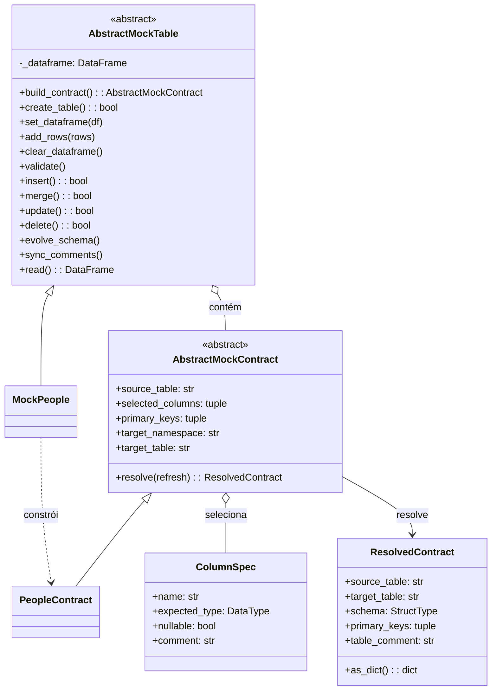

# Diagrama de classes — MockTable

## Herança e composição

## Papéis

- **AbstractMockContract** é a definição estável da tabela: fonte de metadados, colunas selecionadas, chaves, namespace _wks e allowlist.
- **ColumnSpec** permite declarar colunas pelo nome e validar tipos, nullability e comentários herdados da fonte.
- **ResolvedContract** é a forma materializada do contrato, imutável e com somente as colunas selecionadas.
- **AbstractMockTable** administra exclusivamente um workspace DataFrame e o ciclo de vida do destino Delta.
- **PeopleContract e MockPeople** demonstram a separação entre configuração específica e operações herdadas.

Não há dependência de importação do SAFRA ou OLIST; eles são referências arquiteturais.