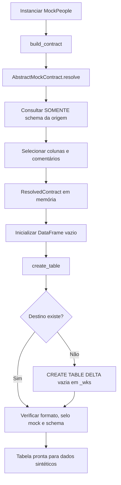
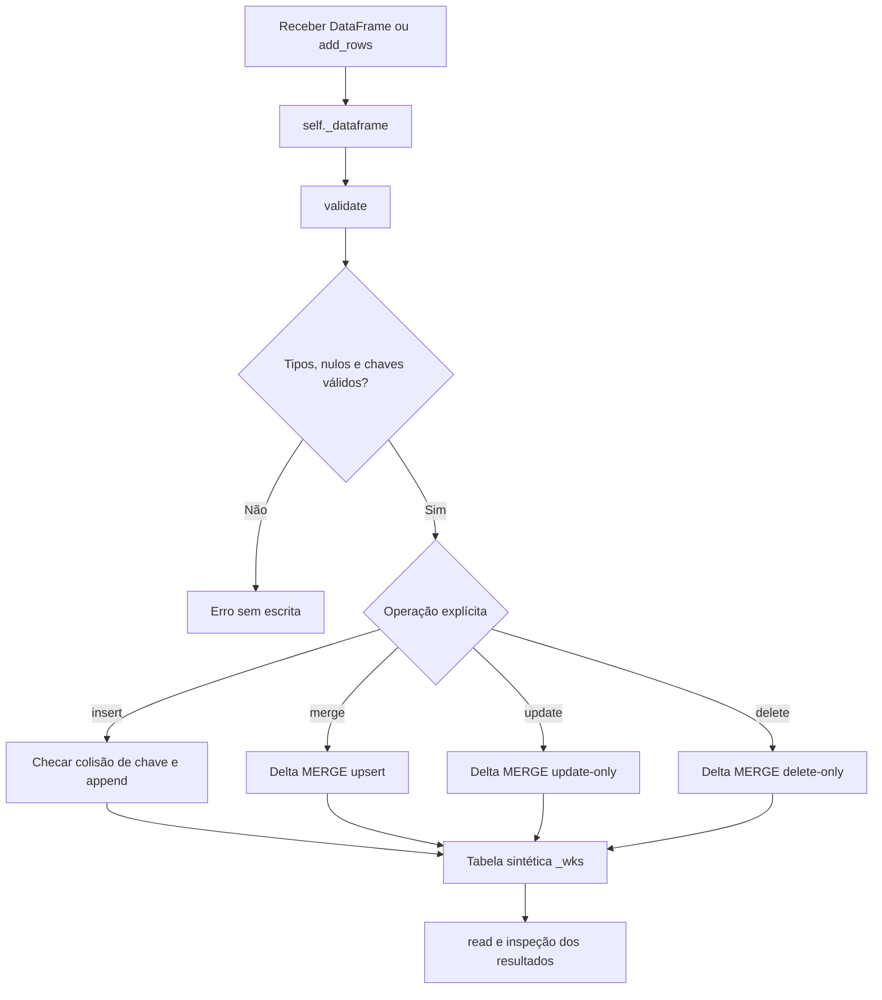
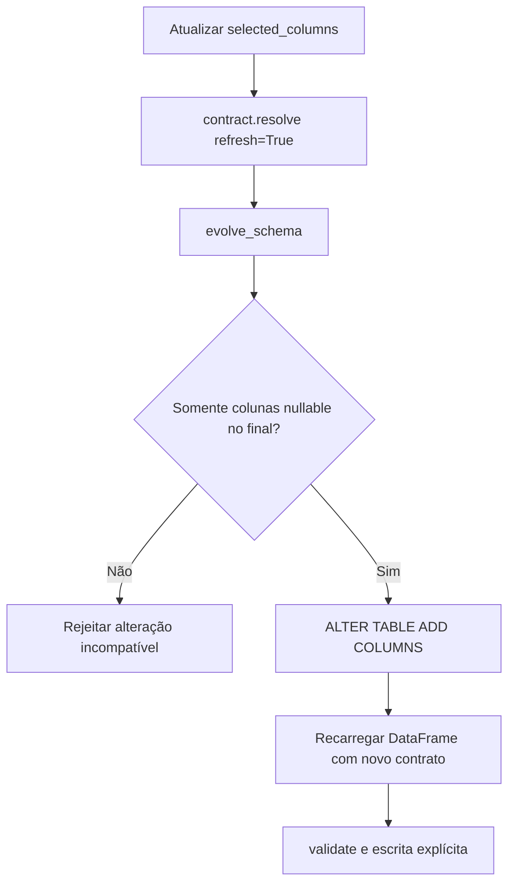

# Fluxogramas de funcionamento — MockTable

## Inicialização e criação de tabela vazia

## Preparação, validação e persistência

## Evolução controlada

**Observação:** os fluxos usam os mesmos métodos do código Python. Nenhum método de atribuição do DataFrame escreve em Delta.