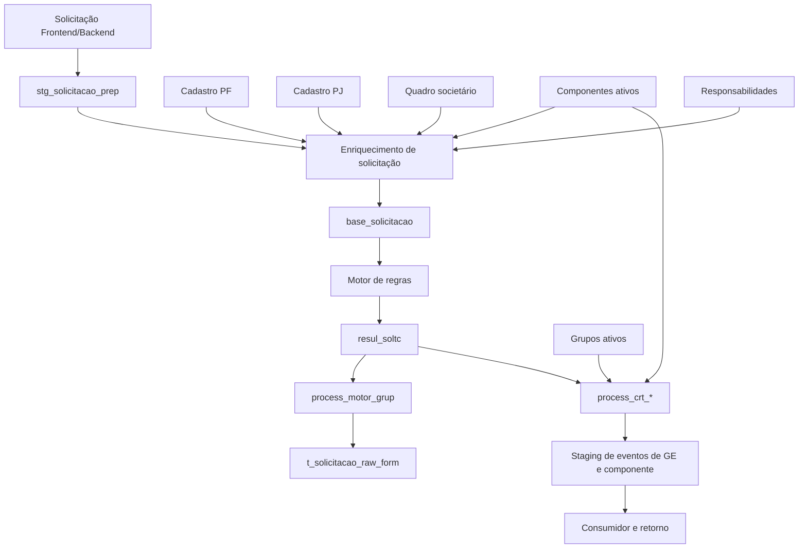

# Massas de teste, chaves e dependências

## Massa de referência existente

| Dataset | Base prevista | Fonte |
|---|---:|---|
| PF cadastral | 100 | Notebook local do time; documentos já definidos |
| PJ cadastral | 100 | Notebook local; 20 com situação diferente de ATIVA, segundo relato de criação |
| Nome comercial de PJ | 100 | `../dados_nomes_pj.py`, chave `cclub_cli` par |
| Grupos ativos | 18 | `../dados_grupos_ativos.py`: 6 do tipo 1, 6 do 5, 6 do 6 |
| Componentes ativos | 48 | `../dados_componentes_ativos.py`: 30 PJ + 18 PF |
| QSA não MEI | 54 vínculos para 27 PJs | `../dados_quadro_societario.py` |
| QSA MEI | Já preparado, total a conferir | Notebook local; não duplicar |
| Responsabilidades | Em preparação/levantamento | Dataset de responsabilidade; cenários positivos e negativos |

Os 18 GEs têm, nesta fixture, dois PJs e um PF por normal/gerencial; um PJ e um PF por isolado. É um **ponto de partida**, não uma matriz que já cobre todos os ramos de exclusão (por exemplo, excluir 2 de 3 PJs exige fixture própria ou restauração parametrizada).

O cadastro foi descrito como inteiramente sintético. Ainda assim, antes da publicação ou de alimentar o banco de teste, a equipe deve confirmar se os documentos fictícios atendem à política interna de dados não produtivos. Não copiar bases reais para completar o que falta.

## Contratos e chaves

| Estrutura | Chave/correspondência conhecida | Cuidados |
|---|---|---|
| PF cadastral | `ccpf_pssoa`; `cclub_cli` ímpar | CPF é string de 11 dígitos |
| PJ cadastral | `ccnpj_empr`; `cclub_cli` par | CNPJ é string de 14 dígitos |
| QSA | `ccnpj_empr` = empresa titular; `ccpf_cnpj_pssoa_soctr` = sócio | `cclub_cli` no QSA **é do sócio**, não da titular |
| Componente ativo | `cgrp_econm` + `ccpf_cnpj_pssoa_coplt` (candidata) | Confirmar unicidade; tipo J/F no destino |
| Grupo ativo | `cgrp_econm` (candidata) | Tipos 1/5/6; schema e metadados do destino |
| Responsabilidade | Raiz CNPJ derivada da solicitação ↔ `ccpf_cnpj` | A janela escolhe o mais recente por chaves de operação |
| Solicitação original ↔ motor | `_id` e `cSoltcAtdmt` | Chave do mapa interno por ação/documento |

O QSA exige cuidado especial: o código antigo de preparação agrupa percentuais por `cclub_cli` e `ccnpj_empr`, embora `cclub_cli` identifique cada sócio. Em empresas com sócios distintos, isso pode fragmentar a soma de 100%. Precisamos testar esse caso com prioridade, sem alterar os dados para disfarçar a divergência.

## Tabelas e etapas do motor

Os YAMLs do ledger mostram preparação de QSA, responsabilidade, solicitação e base; mas **faltam partes do enriquecimento real**. A lista de joins não está integralmente provada. Antes do E2E, conferir os YAMLs e o schema atual.

A origem da solicitação é MongoDB no fluxo recuperado. Um teste exclusivamente sintético precisa preparar essa entrada pelo backend ou por adaptação autorizada; criar tabelas Delta de cadastro não substitui o contrato da solicitação.

## Como usar a massa sem contaminá-la

- Manter os registros literais versionados: mesmos documentos, grupos, nomes, datas e percentuais em DV e HO.
- Para cada cenário, montar estado inicial independente ou restaurar snapshot conhecido. Não acumular alterações de todos os testes em uma tabela compartilhada sem reset.
- Usar operações explícitas das classes Delta depois de validação de schema e dos relacionamentos.
- Não interpretar um INSERT/DELETE em staging como alteração já aplicada no estado ativo. Validar também o consumo.
- Revisar se os novos nomes comerciais de PJ foram aplicados também aos nomes dos sócios PJ no QSA.
- Os CNPJs titulares associados a `cclub_cli` 112, 118 e 120 vieram das listas anteriores: conferir correspondência com o cadastro atual antes de persistir.
- O CRT de exclusão fotografado referencia um campo adicional do componente ativo que não estava entre as quatro colunas da primeira versão reduzida; conferir o schema antes do teste.

## Validadores prévios obrigatórios

1. Cadastros contêm os documentos usados por grupos e QSA.
2. Documentos têm comprimento e tipo coerentes (CPF=11, CNPJ=14).
3. Nenhum componente ativo duplicado no mesmo GE e nenhuma duplicidade entre GEs, exceto em cenários negativos isolados.
4. QSA de cada PJ totaliza 100% nos cenários positivos; valores fora dessa faixa só nos cenários negativos.
5. MEI com um único sócio em sua própria composição; titular de MEI pode também participar de outra PJ conforme os cenários de teste.
6. IDs de GE e `cclub_cli` estáveis, sem conflitos.
7. Fontes roteadas para namespaces de teste; não confiar somente no nome da tabela.
8. Solicitações têm chave e documento coerentes com o frontend/backend.
